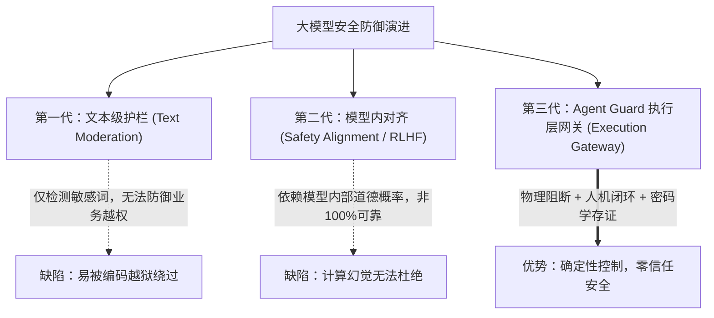

# Agent Guard ｜ 企业级 AI Agent 可信执行与安全控制平台
## 商业计划书 (Business Plan)

> **参赛项目**：Agent Guard V2 —— 独立于大模型的执行控制与安全网关  
> **参赛团队 / 负责人**：[易星衍 / YIXINGYAN — AI Native Builder](https://yixingyan.com/)  
> **个人品牌与研究站点**：[https://yixingyan.com/](https://yixingyan.com/) ｜ 博客：[https://blog.yixingyan.com/](https://blog.yixingyan.com/)  
> **参赛赛事**：MINMAX 粤港澳大湾区创客 AI Agent 黑客松挑战赛  
> **文档版本**：V2.0 商业计划书正式版（2026 年 11 月）

---

## 目录

1. **项目执行摘要 (Executive Summary)**
2. **行业背景与核心痛点 (Problem & Market Need)**
3. **产品哲学与技术架构 (Solution & Architecture)**
4. **六大核心功能与安全壁垒 (Core Features & Moats)**
5. **协议标准与生态兼容 (MCP Ecosystem Integration)**
6. **竞品对比与核心差异化优势 (Competitive Analysis)**
7. **目标客群与典型落地场景 (Target Market & Use Cases)**
8. **商业模式与盈利路径 (Business & Revenue Model)**
9. **创始人与团队背景 (Founder & Team Profile)**
10. **财务预测与发展路线图 (Roadmap & Milestones 2026-2027)**
11. **风险控制与总结展望 (Risk Management & Conclusion)**

---

## 一、 项目执行摘要 (Executive Summary)

### 1.1 一句话定位
**Agent Guard 是企业级 AI Agent 的“数字刹车片与执行安全网关”**——它独立于大模型之外，基于经典安全监视器理论（Reference Monitor），实现“智能供给与执行权力的物理解耦”，让企业敢于放权让 AI Agent 调用真实业务系统。

### 1.2 行业共识与理论基石
微软 CEO Satya Nadella 在 2026 年关于超级智能时代内部风险的论断中指出：
> *"We need to separate the supply of intelligence from the authority over it."*  
> （**我们必须将智能的供给，与执行的权力彻底分开。**）

传统解决方案试图通过“提示词约束（System Prompt）”或“模型内部微调（Safety Alignment）”来实现安全，本质上是让“嫌疑人自己监督自己”，在对抗性提示词注入（Prompt Injection）和模型幻觉面前极易崩溃。

### 1.3 核心破局点
Agent Guard 创造性地将安全防线**外置于模型之外**：
- **模型只管想、只管规划（Supply of Intelligence）**；
- **能否执行、何时执行、改动什么，由独立网关裁决（Authority Over It）**；
- 配备**单点网关、三态策略（放行/审批/硬阻断）、密码学参数绑定、一键全局急停（Kill Switch）与防篡改审计哈希链**，并首个全面兼容 Anthropic 开源的标准 **Model Context Protocol (MCP)**。

---

## 二、 行业背景与核心痛点 (Problem & Market Need)

### 2.1 大模型进入 Agent 落地深水区
2024–2026 年，大模型技术的演进迅速从“单轮对话生成”向“自主智能体（Autonomous Agents）”跃迁。企业不再满足于 AI 聊天，而是要求 Agent 深入真实业务流：查询数据库、发送商务邮件、调用 ERP/CRM、批量生成工单、自动化运维服务器。

### 2.2 企业落地 Agent 的“三大死亡陷阱”
然而，在真实政企客户落地过程中，AI Agent 普遍面临以下致命阻碍，导致**技术可行但业务不敢上线**：

```
                 【传统 Agent 面临的安全死锁】
                 
     用户/外部输入 ───>  大模型 (LLM)  ───>  真实业务系统 API
                           │
             ┌─────────────┴─────────────┐
             ▼                           ▼
      【间接提示词注入】             【幻觉越权操作】
    数据中的黑客诱导指令           误删数据库/滥发未授权邮件
             │                           │
             └─────────────┬─────────────┘
                           ▼
              【企业不敢放权，落地停滞】
```

1. **间接提示词注入（Indirect Prompt Injection）防不胜防**：
   黑客将恶意指令潜伏在正常业务数据中（例如：客户资料备注、求职简历、客服工单文本）。当 Agent 读取该数据进行总结时，注入指令触发，诱导 Agent 调用高危导出 API，泄露全量商业机密。
2. **模型幻觉与不可逆写操作（Hallucinated Actions）**：
   LLM 的概率输出特性意味着无法保证 100% 确定性。一旦 Agent 在调用金融转账、邮件群发、数据删除等写操作时产生幻觉，将直接造成不可逆的经济损失与合规法律风险。
3. **黑盒运行与责任无法溯源（Audit & Compliance Void）**：
   企业内部缺乏统一的可视化监控台。当事故发生时，无法确认是模型决策失误、工具逻辑漏洞还是外部恶意篡改，缺乏符合合规监管的证据链条。

---

## 三、 产品哲学与技术架构 (Solution & Architecture)

Agent Guard 借鉴了计算机安全领域 1970 年代经典的 **引用监视器（Reference Monitor）** 思想：**任何程序都不得绕过或篡改执行其权限的机制**。

### 3.1 核心拓扑架构

```
                    ┌─ Web 控制台（实时运行视图，SSE 事件流） ─┐
                    │  工具请求卡片 → 策略判定 → 内联审批/拒绝  │
                    │  全局急停按钮 · 实时审计时间线            │
                    └──────────────────┬──────────────────────┘
                                       │ 人工决策 / 急停
用户任务 ── Agent ──→  单一网关 gateway.py  ←── 外部 MCP 客户端（/mcp/sse）
（演示/LLM/        propose → policy.evaluate → allow 直接执行
  MCP）            → needs_approval → 审批单 → 阻塞等待人工（可配置超时）
                   → deny → 拒绝 + 审计
                          ↓
                    受控执行器（执行前复查：急停→策略→审批绑定）
                          ↓
                    真实/模拟业务系统 → 审计日志（哈希链，可检测篡改）
                          ↓
                    /api/events（SSE，事件源 = 审计表）
```

### 3.2 架构三大铁律
1. **单一入口（Single Adjudication Entry）**：
   `gateway.adjudicate()` 是所有受保护工具调用的唯一合法入口。无论是内置 Agent、真实 LLM 还是外部 MCP 客户端，均无任何直通底层执行器的物理路径。
2. **执行前复查（Pre-execution Verification）**：
   即使某个操作在先前获得了人工审批，在执行器触发的前一毫秒，系统仍会强制复核：当前是否处于急停状态？审批参数是否被篡改？策略是否依然有效？
3. **审计即真实（Audit as Ground Truth）**：
   实时 Web 事件总线（SSE）直接订阅数据库审计表，绝不在前端模拟或伪造状态，每一条前端动画均严格映射一次后端持久化写入。

---

## 四、 六大核心功能与安全壁垒 (Core Features & Moats)

| # | 核心功能 | 技术实现与安全语义 | 业务价值 |
|---|---|---|---|
| **1** | **单一网关强制裁决** | `gateway.py` 统筹裁决，外置策略引擎，前端非安全边界 | 彻底封死 Agent 直连数据库与第三方 API 的可能性 |
| **2** | **三态自适应策略** | `allow`（安全读操作直通）、`needs_approval`（敏感写操作挂起）、`deny`（越权导出硬阻断） | 兼顾业务运转效率与高危风险阻断 |
| **3** | **密码学参数绑定** | 审批单绑定 `scope_hash = sha256(tool + canonical_json(params))`，一次一用，30分钟 TTL | 防止“特洛伊木马式”审批篡改（批的是A，执行的却是B） |
| **4** | **全局人工急停制动** | 一键紧急制动，所有未开始动作转入 `blocked_by_stop` 终态，仅允许管理员显式恢复 | 在系统失控或遭受未知攻击时秒级熔断止损 |
| **5** | **不可篡改审计哈希链** | 每一条审计事件包含前序事件的 SHA-256 哈希，构成轻量级账本链条 | 提供符合等保与金融合规要求的“可检测篡改”审计凭证 |
| **6** | **成本与调用熔断** | `llm_budget.py` 实现每日调用硬上限、单任务步数上限与一键停用 | 防止死循环调用导致百万 Token 天价账单 |

---

## 五、 协议标准与生态兼容 (MCP Ecosystem Integration)

### 5.1 首个原生集成 Anthropic Model Context Protocol (MCP) 的安全平台
Model Context Protocol（MCP）是 2024 年底由 Anthropic 提出、目前正迅速成为全球标准的 AI 协议，旨在统一大模型与外部工具/数据源的连接规范。

Agent Guard 在服务端原生挂载了标准 MCP 适配层（`/mcp/sse`）：
- **工具标准发现**：提供 `crm_read`、`crm_update`、`mail_send`、`crm_export_all` 等标准工具声明；
- **全生态无缝即插即用**：任何支持 MCP 的外部 Agent（例如：Claude Desktop、Cursor、Cline、自研 Agent 框架）无需改造，只需在配置文件中填入 Agent Guard 的端点，即可瞬间接入受保护的企业工具库；
- **统一权限管控**：外部客户端调用工具时，必须阻塞等待 Agent Guard 网关的裁决或人工审批，真正实现**“跨生态、一站式”**的安全管辖。

---

## 六、 竞品对比与核心差异化优势 (Competitive Analysis)

当前市场上关于“大模型安全”的产品主要集中在内容安全层（如 OpenAI Moderation, Meta Llama Guard, NeMo Guardrails），与 Agent Guard 存在代际差异：



### 竞品核心维度深度对照表

| 评估维度 | 传统文本级 Guardrail (如 Llama Guard) | 提示词护栏系统 (如 NeMo Guardrails) | **Agent Guard 执行控制平台** |
| :--- | :--- | :--- | :--- |
| **安全锚点** | 输入/输出的自然语言文本 | 对话流程脚本与模型微调 | **真实系统 API 与执行器物理层** |
| **防 Prompt Injection** | 脆弱（易被 Base64、多语言、角色扮演越狱） | 较脆弱（增加系统提示词复杂度） | **硬阻断（网关策略直接 deny，无视模型是否被骗）** |
| **高危写操作保护** | 无机制（只管生成，不管调用） | 仅能建议拒绝 | **强制挂起（Human-in-the-loop + 密码学一次性令牌）** |
| **系统失控紧急制动** | 无（只能强杀服务器进程） | 依赖配置重新加载 | **全局一键急停（Kill Switch）秒级止损** |
| **审计与责任认定** | 无或普通文本日志 | 普通记录 | **密码学哈希链，保证防篡改与司法级存证** |
| **跨生态适配** | 需硬编码集成在特定框架内 | 绑定特定 Python 生态 | **标准 MCP 协议，支持任意外部 Agent 客户端** |

---

## 七、 目标客群与典型落地场景 (Target Market & Use Cases)

### 7.1 目标企业客户画像
Agent Guard 聚焦于**对业务误操作零容忍、对数据资产高度敏感、受严格合规监管**的企业客户：
- **银行、证券与保险机构**：需要 Agent 自动化分析流水，但严禁 Agent 自主发起资金划转或全量客户数据导出；
- **大型企事业单位与政务部门**：需要 Agent 处理公文与工单，但涉及发文、签章、对外公告必须经过人类岗位确认；
- **医疗健康与医药研发**：严防患者隐私数据通过 Agent 交互泄露，所有处方与分析动作需留存不可篡改审计链条；
- **高科技出海与跨境企业**：满足 GDPR、网络安全法与数据出境安全评估标准。

### 7.2 典型落地业务场景

#### 场景 1：企业 CRM 与外呼销售 Agent
- **只读分析**：Agent 自动读取客户历史消费行为，生成画像（`allow` 放行）。
- **敏感触达**：Agent 生成针对性挽留邮件与优惠券，触发人工审批通道，销售主管在企业微信/飞书上一键确认后外发（`needs_approval` 闭环）。
- **数据防窃**：黑客通过恶意客户名嵌入 Prompt Injection 企图诱导下载企业全量客资，网关瞬间拦截并报警（`deny` 阻断）。

#### 场景 2：IT 基础设施与自动化运维 Agent (DevOps / SRE)
- Agent 自主排查日志并汇总故障原因；
- 一旦 Agent 计划执行重启集群、格式化硬盘或修改防火墙规则，必须进入审批，并受全局急停按钮随时监控。

---

## 八、 商业模式与盈利路径 (Business & Revenue Model)

Agent Guard 采用成熟的 **Open-Core（开源内核 + 商业企业版）** 商业模式：

```
                    ┌───────────────────────────────┐
                    │  开源社区版 (Open-Source)     │
                    │  • 核心网关 gateway.py        │
                    │  • 基础三态策略与单节点 SQLite │
                    │  • 标准 MCP 接口与 Web 控制台  │
                    └───────────────┬───────────────┘
                                    │ 开发者生态沉淀 / 自下而上获客
                                    ▼
                    ┌───────────────────────────────┐
                    │  企业商业版 (Commercial SaaS)  │
                    │  • 分布式高可用网关集群       │
                    │  • 飞书/钉钉/企业微信审批流直连│
                    │  • 细粒度 RBAC 权限与审计导出  │
                    │  • 动态策略热重载与多租户管理 │
                    └───────────────┬───────────────┘
                                    │ 标杆客户私有化落地
                                    ▼
                    ┌───────────────────────────────┐
                    │  政企私有化部署与信创合规定制 │
                    │  • 纯离线环境 / 涉密内网部署   │
                    │  • 军工/金融特定加密算法与国密 │
                    │  • 年度维保与专业实施咨询服务 │
                    └───────────────────────────────┘
```

### 8.1 盈利管道设计
1. **开发者版（免费开源）**：开源核心网关与开发工具链，快速占据 GitHub、开发者社区与 MCP 生态心智；
2. **企业 SaaS 订阅版（按席位/流量计费）**：
   - 基础版：¥1,999 / 月（支持管理 5 个 Agent 实例，10 万次/月调用裁决）；
   - 专业版：¥5,999 / 月（支持管理 20 个 Agent 实例，集成飞书/钉钉审批流，保留 1 年哈希链审计）；
3. **私有化合规部署与信创许可（按实例/年费）**：
   - 针对大型金融机构与政企客户，单套部署许可 ¥20万 ~ ¥50万，包含定制策略开发与信创数据库适配。

---

## 九、 创始人与团队背景 (Founder & Team Profile)

### 创始人：易星衍 (YIXINGYAN)
- **个人品牌与研究站点**：[https://yixingyan.com/](https://yixingyan.com/)
- **专业博客与思想库**：[https://blog.yixingyan.com/](https://blog.yixingyan.com/)
- **定位**：**AI-Native Builder**，长期专注企业 AI 落地、AI 原生构建与出海数字基础设施。
- **核心工程与行业实践经历**：
  - **政企客户服务与大型项目交付**：具备政企行业客户服务、信创项目推进及交付验收经历；参与行业规范编制与安全白皮书撰写。
  - **前沿 AI 工程研究与实践 (AI Engineering)**：
    * 深度研究企业级 Agent 评估体系（Eval）、Human-in-the-loop 人机协同范式、FDE 与前线共创模式；
    * 具备完整的 Planner / Executor 架构拆解、Context Engineering、多智能体协同（Multi-Agent）与可信执行架构落地经验；
    * 践行“把真实业务问题做成可运行系统”的 AI-Native Engineering 理念。

---

## 十、 财务预测与发展路线图 (Roadmap & Milestones 2026-2027)

### 10.1 技术与产品路线图

| 时间节点 | 版本与阶段 | 核心交付里程碑 |
|---|---|---|
| **2026 Q4 (当前)** | **V2.0 原型交付** | 单一网关重构、三态策略引擎、密码学 scope_hash 审批、标准 MCP 接入、全量 50 项测试通过 |
| **2027 Q1** | **V2.5 企业连接器** | 深度集成飞书、钉钉、企业微信与 Slack 移动端审批卡片；支持企业单点登录 (SSO) 与 RBAC |
| **2027 Q2** | **V3.0 智能策略引擎** | 引入“影子运行模式（Shadow Mode）”，AI 自动学习历史人工审批记录并建议网关放行规则 |
| **2027 Q3** | **V3.5 分布式集群** | 支持万级 QPS 并发网关路由，支持国密 SM2/SM3/SM4 审计算法与信创环境原生认证 |

### 10.2 商业化收入预期
- **第一年 (2027)**：沉淀 10 家中大型标杆付费客户（涵盖金融与头部出海电商），实现年 ARR ¥150 万。
- **第二年 (2028)**：依托 MCP 生态构建企业安全网关标准标准件，服务 80+ 付费企业，ARR 突破 ¥600 万。

---

## 十一、 风险控制与总结展望 (Risk Management & Conclusion)

### 11.1 风险应对预案
1. **模型生态碎片化风险**：各大模型厂商协议差异可能导致接入难度增加。  
   *对策*：全面拥抱中立、开源的 **Model Context Protocol (MCP)** 标准，以标准协议向下兼容所有主流大模型生态。
2. **网关延迟性能损耗**：增加一层网关裁决是否会显著拖慢 Agent 运行速度？  
   *对策*：网关采用极轻量化的内存策略评估器，非审批类动作判定耗时低于 2ms，对业务响应无感知。

### 11.2 参赛总结
> **“智能的供给，与执行的权力分开。”**  
> 这不仅是行业领袖的前瞻预言，更是千行百业拥抱 AI Agent 必须跨越的信任鸿沟。  
> **Agent Guard 已经给出了工程化解法的最优答案。**
